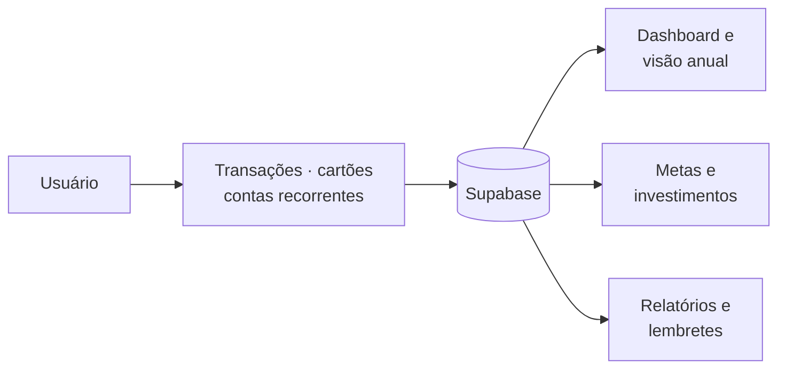

> **🔵 Funcional, em testes internos antes do lançamento**
>
> 🔒 Este é um repositório vitrine: o código-fonte é privado porque o produto é comercial. Aqui estão o problema, a solução, a arquitetura e os resultados. Demonstração técnica sob pedido.

## O problema

Controlar gastos, cartões, contas recorrentes e metas costuma exigir vários apps ou uma planilha que ninguém mantém atualizada.

## A solução

Um app que reúne a vida financeira pessoal em um painel só, do lançamento de uma compra parcelada ao acompanhamento de metas e investimentos.

## Funcionalidades

- Dashboard e visão anual
- Transações, cartões e categorias
- Contas recorrentes e lembretes
- Investimentos e metas (cofrinhos)
- Relatórios
- Planos de assinatura

## Como funciona

## Stack

| Camada | Tecnologias |
|---|---|
| Front-end | React, Vite, shadcn/ui |
| Dados | Supabase |

## Resultados

- Compras parceladas modeladas como transações individuais, o que simplifica relatórios e visão mensal

<!-- Para mostrar telas: coloque os prints em ./docs e descomente o bloco abaixo
## Telas

-->

---

Desenvolvido por <b>Wiliam Bonetti</b> · <a href="https://portfolio.wbonetti.com.br">portfólio</a> · <a href="https://www.linkedin.com/in/wiliam-bonetti">linkedin</a> · <a href="https://www.instagram.com/willbonetti">instagram</a> · <a href="mailto:wiliam.bonetti@gmail.com">e-mail</a>

